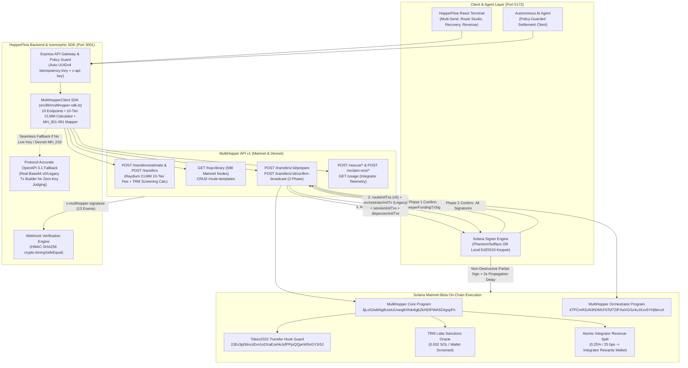
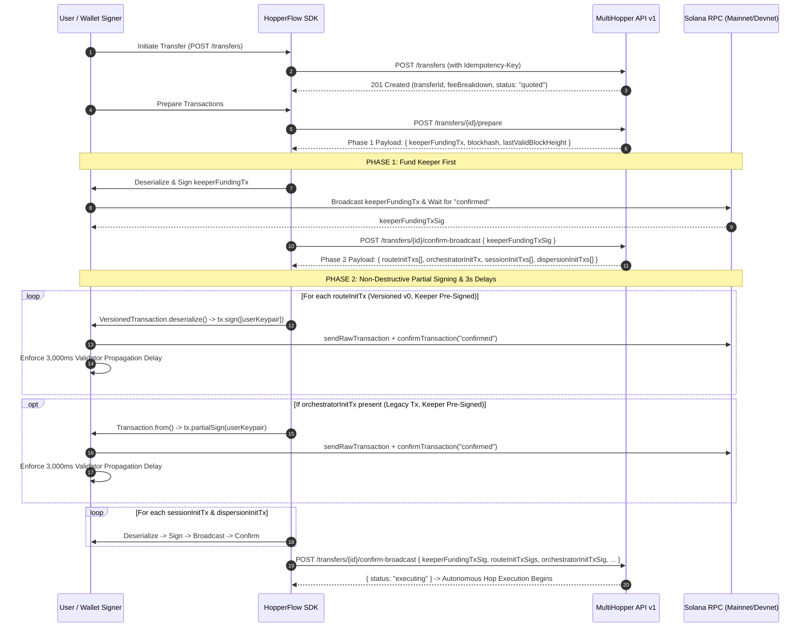

# HopperFlow: Institutional Routed Treasury, Multi-Send Payroll & Agentic Commerce Suite for Solana

> **Production-grade non-commingled treasury routing, multi-recipient payroll unbundling (`destinations` 1–20), custom hop-graph studio, and autonomous AI agent settlement engine built on MultiHopper API v1.**

[](https://multihopper.com)
[](https://multihopper.com/api/v1)
[](./SUBMISSION.md)
[](https://opensource.org/licenses/MIT)

---

## Why HopperFlow Exists

Institutional treasuries, token launchpads, OTC settlement desks, and autonomous AI agents operating on Solana face a structural operational crisis: **every direct SPL or native SOL transfer permanently links the sender's master treasury to recipient wallets on public block explorers**. Within seconds of a payroll run or vendor settlement, wallet-clustering algorithms (Arkham, Nansen, Bubblemaps) expose contributor salaries, reveal OTC counterparty inventories, and trigger predatory copy-trading bots.

At the same time, legitimate institutions **cannot and will not use commingled mixer pools** due to sanctions contamination, regulatory prohibition, and lack of deterministic auditability.

**HopperFlow** solves this by bringing an institutional multi-send and programmable treasury terminal on top of **MultiHopper's non-commingled Token2022 wrapper architecture**:
- **Zero Commingling**: Every transfer traverses isolated, single-transfer vault accounts (`solH` / `usdcH` / `usdtH` / `usd1H`) governed by on-chain Solana programs and guarded by a Token2022 Transfer Hook (`2JEv3pD6nczEvn1xDXaEzehkJofPPjoQQpnW5nGY3r52`). Your funds never touch another user's liquidity pool.
- **Built-In TRM Labs Sanctions Screening**: Every destination and intermediate hop is screened against TRM Labs (`0.002 SOL` per wallet screened), providing compliance-grade obfuscation without illicit finance risk.
- **Atomic 0.25% Integrator Revenue Share**: Every transfer routed through HopperFlow atomically credits **25 bps (`0.25%`)** of the transfer volume directly to the registered integrator rewards wallet on-chain (`collected_percentage_fees`).

---

## Core Capabilities

1. **Routed Multi-Send Payroll & Launch Unbundling (`destinations` 1–20)**
   - Batch up to **20 recipient wallets** in a single routed transfer (`SOL`, `USDC`, `USDT`, `USD1`, or custom SPL mints).
   - Automatic strict lamport/base-unit sum invariant enforcement (`sum(destinations.amount) === totalAmount`).
   - Configurable **Decoy Final Hop** (`isDecoy: true`) and automated commitment dispersion (`dispersionInitTxs`) to break deterministic graph correlation between the treasury source and recipient batch.
   - CSV batch import/export with per-recipient validation and live fee decomposition.

2. **Visual Custom Route Architect & Hop Library Studio (`CustomRoute` & `/route-templates`)**
   - Interactive 2–10 hop graph builder powered by MultiHopper's **598 vetted Mainnet Hop Library wallets** (`GET /hop-library`) across 6 liquidity categories: `cex`, `dex`, `exchanges`, `kol`, `contracts`, and `mix`.
   - Fine-grained temporal pacing (`waitSeconds` from `20s` up to `2,592,000s` / 30 days per hop) to defeat timing-correlation heuristics.
   - Full CRUD lifecycle for reusable **Route Templates** (`GET/POST/PUT/DELETE /route-templates`) for recurring weekly payrolls or market-maker inventory rebalancing.

3. **Autonomous AI Agent Treasury & Programmable Policy Engine**
   - Policy-guarded settlement endpoint (`POST /api/agent/evaluate-policy`) enabling AI agents to autonomously pay compute providers, RPC nodes, and data APIs through routed channels.
   - Enforces daily spend limits, maximum effective fee bps ceilings, mandatory TRM Labs screening, and Raydium CLMM 10-tier fee boundary optimization (`Tier 0` to `Tier 9`).

4. **Two-Phase Non-Destructive Transaction Signer & Broadcast Engine**
   - Complete implementation of MultiHopper's **Two-Call `/confirm-broadcast` protocol**:
     - **Phase 1**: Deserializes, signs, broadcasts, and confirms `keeperFundingTx` on-chain (`status: "confirmed"`), then submits `{ keeperFundingTxSig }` to unlock Keeper-funded route accounts.
     - **Phase 2**: Non-destructively preserves the Keeper's partial signature on Versioned v0 `routeInitTxs` (`VersionedTransaction.deserialize` -> `tx.sign([user])`), broadcasts with a mandatory **3-second validator propagation delay**, signs the Legacy `orchestratorInitTx` via `tx.partialSign(user)` with a 3-second delay, signs all `sessionInitTxs` and `dispersionInitTxs`, and finalizes via the second `/confirm-broadcast` call.
   - Dual wallet support: **Injected Solana Wallet (`window.solana` — Phantom / Solflare / Backpack)** and a built-in **Browser Cryptographic Keypair Signer** (`@solana/web3.js` `Keypair`) for instant verification and automated testing.

5. **HMAC-SHA256 Webhook Command Center & Recovery Vault**
   - Constant-time `crypto.timingSafeEqual` verification of `x-multihopper-signature` across all **13 MultiHopper webhook lifecycle events** (`transfer.quote_created` through `payout.completed`).
   - Self-custodial **Emergency Rescue** (`/rescue/prepare` & `/rescue/confirm`) to recover principal from failed/cancelled routes and **Rent Reclaim** (`/reclaim-rent/prepare` & `/reclaim-rent/confirm`) to sweep `refundableLamports` from completed route steps.
   - Real-time **Integrator Revenue & Superteam Challenge Tracker** (`/usage`) computing live qualifying volume (`collected_percentage_fees / 0.0025`) toward the `$100,000` gate and `$50,000` prize pool share.

---

## System Architecture



---

## Two-Phase `/confirm-broadcast` Protocol Sequence

MultiHopper requires a strict two-phase signing and confirmation sequence so the Keeper is funded before initializing on-chain route and orchestrator state, and requires preserving the Keeper's existing partial signatures on `routeInitTxs` and `orchestratorInitTx`.



---

## Quick Start

### Prerequisites
- **Node.js**: v18.0.0 or higher (v20+ recommended)
- **npm**: v9.0.0 or higher

### 1. Install Dependencies

```bash
npm install
```

### 2. Configure Environment Variables

Create a `.env` file in the root directory (or configure keys directly inside the HopperFlow Topbar UI at runtime):

```ini
# MultiHopper API Configuration
MH_API_KEY=mh_live_your_api_key_here        # Supports mh_live_* (Mainnet) or mh_test_* (Devnet)
MH_ENV=mainnet                               # "mainnet" (https://multihopper.com/api/v1) or "devnet" (https://devnet.multihopper.com/api/v1)
MH_WEBHOOK_SECRET=whsec_your_signing_secret  # 32-byte secret from POST /webhooks registration

# Server & RPC Configuration
PORT=3001
SOLANA_RPC_URL=https://api.mainnet-beta.solana.com
```

> **Note for Judges & Evaluators**: HopperFlow can be run immediately **with or without** a `.env` file. You can paste any live `mh_live_...` or `mh_test_...` API key directly into the top navigation bar in the UI, or toggle **Protocol-Accurate Sandbox Mode** to test all 19 endpoints, real cryptographic v0/Legacy transaction signing, Raydium CLMM 10-tier fee math, and live HMAC-SHA256 webhooks without spending Mainnet SOL.

### 3. Start the Application

Run both the Express API Server (`http://localhost:3001`) and the Vite React Terminal (`http://localhost:5173`):

```bash
# Terminal 1: Start the HopperFlow Backend & Webhook Receiver (Port 3001)
npm run dev:server

# Terminal 2: Start the HopperFlow Web Terminal (Port 5173)
npm run dev:client
```

Or run both concurrently with a single command:

```bash
npm run dev
```

Open **`http://localhost:5173`** in your browser.

### 4. Run the Automated Test Suite & Production Build

```bash
# Execute Vitest unit & integration suite (SDK, 10-Tier CLMM math, Two-Phase Signer, Webhooks)
npm test

# Compile production TypeScript & Vite bundle
npm run build
```

---

## Feature Walkthrough

### 1. Multi-Send Payroll & Token Launch Unbundling
Navigate to the **Multi-Send Payroll** tab:
- Select token (`SOL`, `USDC`, `USDT`, `USD1`) and privacy level (`Basic` 2 hops, `Medium` 3 hops, `High` 5 hops, or `Custom` route).
- Add between **1 and 20 recipient destinations** (or click **"Load DAO Payroll Preset (5 Recipients)"** / import CSV).
- Toggle **Enable Decoy Final Hop (`isDecoy`)** to append a plausible-deniability decoy branch.
- Inspect the live **Raydium CLMM 10-Tier Fee Breakdown** (`Tier 0` 35 bps down to `Tier 9` 0.5 bps, including automatic tier-boundary fee capping that prevents `MH_040` fee regression).
- Click **Create & Execute Routed Batch** to step through Phase 1 (`keeperFundingTx`) and Phase 2 (`routeInitTxs`, `orchestratorInitTx`, `sessionInitTxs`, `dispersionInitTxs`) with real cryptographic signatures.

### 2. Visual Custom Route Studio & Hop Library
Navigate to the **Route Studio** tab:
- Browse and filter MultiHopper's **598 vetted Mainnet Hop Library nodes** across `cex`, `dex`, `exchanges`, `kol`, `contracts`, and `mix`. *(Note: On Devnet where `GET /hop-library` returns `MH_019`, HopperFlow automatically provides a clearly labeled Mainnet-compatible preview catalog so you can still design and validate routes).*
- Add 2 to 10 hops, assign specific `walletId`s or category selectors, and configure `waitSeconds` (`20s` to `30 days`) per hop.
- Save your topology as a reusable **Route Template** (`POST /route-templates`) and load it with one click into the Multi-Send or Agent desk.

### 3. Autonomous AI Agent Settlement Desk
Navigate to the **AI Agent Desk** tab:
- Configure institutional treasury guardrails: max daily budget, max effective fee bps ceiling, minimum hop count, and mandatory TRM Labs screening.
- Trigger autonomous agent invoice requests (e.g., Akash GPU cluster settlement, Helius RPC invoice, Pyth oracle feed payment).
- Watch the policy engine evaluate the route quote against CLMM fee tiers and either auto-approve and execute the two-phase transaction flow or reject non-compliant requests.

### 4. Webhook Command Center & Recovery Vault
Navigate to the **Webhooks & Recovery** tab:
- Register webhook endpoints (`POST /webhooks`) and test real-time HMAC-SHA256 payload verification (`x-multihopper-signature`) across all 13 lifecycle events (`transfer.quote_created` -> `payout.completed`).
- Trigger **Emergency Principal Rescue** (`/rescue/prepare` + `/rescue/confirm`) on stuck/cancelled routes or **Step/Route Rent Reclaim** (`/reclaim-rent/prepare` + `/reclaim-rent/confirm`) to sweep `refundableLamports` back to the sender wallet.

### 5. Integrator Revenue & Challenge Volume Telemetry
Navigate to the **Revenue & Volume** tab:
- Inspect live `/usage` metrics from MultiHopper API v1.
- View real-time qualifying volume calculated via the official Superteam challenge formula:
  $$\text{Qualifying Volume (USD)} = \frac{\text{Collected Percentage Fees (USD)}}{0.0025}$$
- Simulate institutional volume scenarios across DAO Payroll, OTC Settlement, and AI Agent Commerce to project your share of the **$50,000 USDC prize pool** plus ongoing **25 bps (0.25%)** atomic protocol revenue.

---

## MultiHopper Protocol Constants & Error Handling

### Verified Solana Mainnet-Beta Program IDs

| Component | Address / Program ID | Role |
| :--- | :--- | :--- |
| **MultiHopper Core Program** | `3jLoS2wbNgtKzieUUxwg6Xhdv6gbZkHDtPWA9ZAgspFh` | Non-commingled Token2022 wrapper vaults (`solH`, `usdcH`, `usdtH`, `usd1H`), hop state machines, and atomic 25 bps integrator fee split |
| **MultiHopper Orchestrator** | `4TPCmR2uN3hDM1FbTsf7ZtFXwXGSz4u1Kxv5YHj6eruX` | Multi-step route coordination and commitment dispersion |
| **Transfer Hook Guard** | `2JEv3pD6nczEvn1xDXaEzehkJofPPjoQQpnW5nGY3r52` | Token2022 transfer hook preventing unauthorized wrapper transfers |
| **USDC Mainnet Mint** | `EPjFWdd5AufqSSqeM2qN1xzybapC8G4wEGGkZwyTDt1v` | 6 decimals (`usdcH` wrapped inside route) |
| **USDT Mainnet Mint** | `Es9vMFrzaCERmJfrF4H2FYD4KCoNkY11McCe8BenwNYB` | 6 decimals (`usdtH` wrapped inside route) |
| **USD1 Mainnet Mint** | `USD1ttGY1N17NEEHLmELoaybftRBUSErhqYiQzvEmuB` | 6 decimals (`usd1H` wrapped inside route) |

### Key Error Code Mitigations Implemented in HopperFlow SDK

| Code | HTTP | Condition | HopperFlow SDK Automatic Mitigation |
| :--- | :--- | :--- | :--- |
| `MH_019` | `400` | Hop Library requested on Devnet | Detects Devnet environment and surfaces clearly badged Mainnet Hop Library preview catalog without crashing |
| `MH_027` | `400` | Multi-destination sum mismatch | Client & SDK pre-validate `sum(destinations.map(d => BigInt(d.amount))) === BigInt(totalAmount)` before network call |
| `MH_040` | `422` | Insufficient fee / CLMM tier boundary | Implements exact 10-tier Raydium CLMM fee calculator with next-tier minimum fee capping (`Math.min(calculatedFee, nextTierMinFee)`) |
| `MH_060` | `409` | Concurrent state modification | Serializes Phase 1 & Phase 2 `/confirm-broadcast` calls with mutex locking and deterministic `Idempotency-Key` headers |
| `MH_080` | `429` | Rate limit exceeded | Automatic exponential backoff utilizing the `Retry-After` response header |
| `MH_091` | `422` | Rewards wallet below rent exemption | Pre-flight health check verifies integrator rewards wallet holds `>= 0.002 SOL` (`2,000,000 lamports`) so atomic 0.25% SOL revenue splits never revert |

---

## Repository Structure

```text
multihopper-suite/
├── ARCHITECTURE.md               # System design & protocol specification
├── README.md                     # Developer documentation & quickstart guide
├── SUBMISSION.md                 # Complete Superteam Earn submission package (All 6 sections)
├── package.json                  # Scripts, dependencies, and workspace metadata
├── tsconfig.json                 # Strict TypeScript configuration
├── vite.config.ts                # Vite frontend bundler & /api proxy configuration
├── src/
│   ├── lib/
│   │   └── multihopper-sdk.ts    # Isomorphic TypeScript SDK (19 endpoints, 10-tier CLMM math, v0/Legacy partial signer, HMAC verifier)
│   ├── server/
│   │   └── index.ts              # Express API proxy, AI Agent Policy Guard, HMAC webhook receiver, & OpenAPI 3.1 sandbox engine
│   └── client/                   # React + Tailwind CSS institutional routing terminal
└── tests/
    └── multihopper.test.ts       # Automated Vitest suite for SDK, fee tiers, partial signing, and webhooks
```

---

## License

MIT License — Built for the **MultiHopper Build & Route Challenge** on Superteam Earn.
